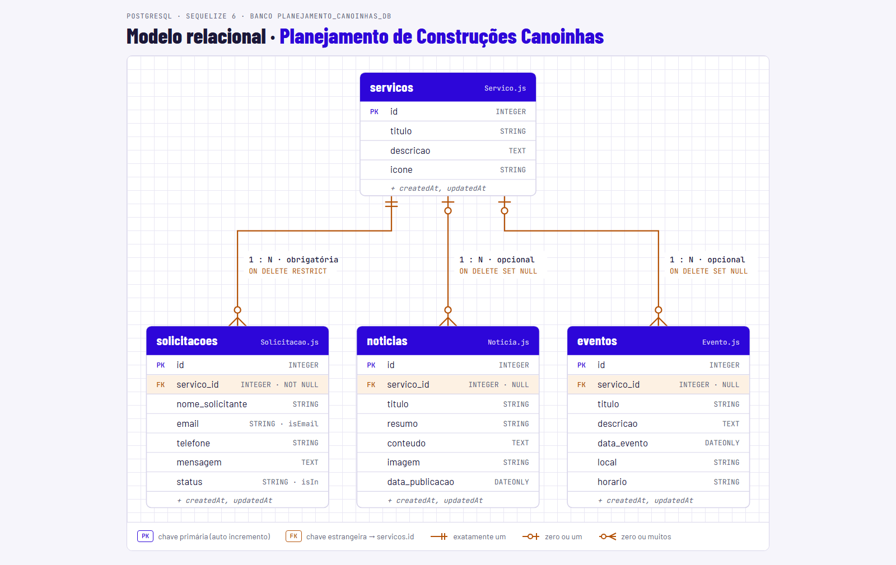

# Planejamento de Construções Canoinhas

Aplicação Web **Full Stack** desenvolvida para o Trabalho Avaliativo 3 da disciplina **Programação Web II**.

**Regra de negócio:** site institucional de uma empresa de planejamento de construções. O site mostra os **serviços** da empresa, publica **notícias** e **eventos**, e recebe **solicitações de orçamento** dos clientes. Os dados vêm de uma API RESTful em Node.js e ficam gravados em um banco PostgreSQL.

> Para instalar e rodar o projeto em outro computador, veja o passo a passo em **[INSTALACAO.md](INSTALACAO.md)**.

---

## Tecnologias

| Camada | Tecnologia |
|---|---|
| Banco de dados | PostgreSQL |
| ORM | Sequelize 6 |
| Backend (API) | Node.js + Express 5 (JavaScript) |
| Autenticação | JWT (`jsonwebtoken`) + hash de senha (`bcryptjs`) |
| Frontend | HTML5, CSS3 e JavaScript puro (`fetch()`) |
| Ícones / Fontes | Phosphor Icons e Google Fonts |

---

## Estrutura de pastas

```
planejamento_canoinhas-main/
├── README.md                  ← este arquivo
├── INSTALACAO.md              ← guia de instalação
├── docs/
│   ├── diagrama-er.png        ← diagrama do banco (imagem)
│   └── modelo-relacional.html ← diagrama do banco (página completa)
│
├── backend/                   ← API RESTful
│   ├── index.js               ← ponto de entrada: cria o servidor e sincroniza o banco
│   ├── package.json
│   └── src/
│       ├── config/
│       │   └── database.js    ← conexão com o PostgreSQL
│       ├── database/
│       │   └── seed.js        ← carga inicial de dados de teste + admin padrão
│       ├── middlewares/
│       │   └── auth.js        ← confere o token JWT nas rotas protegidas
│       ├── utils/
│       │   └── tratarErro.js  ← decide entre 400 e 500
│       ├── models/            ← CAMADA DE MODELO (tabelas)
│       │   ├── index.js       ← relacionamentos entre os models
│       │   ├── Servico.js
│       │   ├── Solicitacao.js
│       │   ├── Noticia.js
│       │   ├── Evento.js
│       │   └── Usuario.js     ← administradores (login)
│       ├── controllers/       ← CAMADA DE CONTROLE (regras e respostas HTTP)
│       │   ├── ServicoController.js
│       │   ├── SolicitacaoController.js
│       │   ├── NoticiaController.js
│       │   ├── EventController.js
│       │   └── AuthController.js  ← POST /login, gera o token
│       └── routes/            ← CAMADA DE ROTAS (URLs → controllers)
│           ├── index.js       ← agrupa todas as rotas em /api
│           ├── ServicoRoutes.js
│           ├── SolicitacaoRoutes.js
│           ├── NoticiaRoutes.js
│           ├── EventRoutes.js
│           └── AuthRoutes.js
│
└── frontend/                  ← site que consome a API
    ├── index.html             ← site público
    ├── css/style.css
    ├── js/script.js           ← chamadas fetch() e renderização dinâmica
    ├── img/
    └── admin/                 ← painel administrativo (CRUD completo)
        ├── index.html         ← tela de login
        ├── dashboard.html     ← painel (exige login)
        ├── css/admin.css
        └── js/
            ├── login.js       ← POST /login e salva o token
            └── admin.js       ← GET, POST, PUT e DELETE com o token
```

### Como as camadas funcionam juntas

```
Navegador (fetch)  →  routes  →  controllers  →  models (Sequelize)  →  PostgreSQL
        ↑                                                                    │
        └──────────────────── resposta JSON + status HTTP ←──────────────────┘
```

1. **Rotas** (`routes/`): definem a URL e o método HTTP e chamam a função do controller.
2. **Controllers** (`controllers/`): validam os dados recebidos, usam o model e devolvem o JSON com o status HTTP correto.
3. **Models** (`models/`): representam as tabelas. O Sequelize converte os métodos (`findAll`, `create`, `update`, `destroy`) em SQL.

---

## Modelo do banco de dados

São 4 tabelas, todas relacionadas à tabela `servicos` por chave estrangeira (relações **1:N**, um para muitos).



> A versão interativa do diagrama, com a tabela de relacionamentos e o código das associações, está em [`docs/modelo-relacional.html`](docs/modelo-relacional.html). Abra o arquivo no navegador.

```
                 ┌────────────────────┐
                 │      servicos      │
                 │ PK id              │
                 │    titulo          │
                 │    descricao       │
                 │    icone           │
                 └─────────┬──────────┘
        ┌──────────────────┼───────────────────┐
        │ 1:N              │ 1:N               │ 1:N
┌───────▼──────────┐ ┌─────▼────────────┐ ┌────▼─────────────┐
│   solicitacoes   │ │     noticias     │ │     eventos      │
│ PK id            │ │ PK id            │ │ PK id            │
│ FK servico_id *  │ │ FK servico_id    │ │ FK servico_id    │
│    nome_solic.   │ │    titulo        │ │    titulo        │
│    email         │ │    resumo        │ │    descricao     │
│    telefone      │ │    conteudo      │ │    data_evento   │
│    mensagem      │ │    imagem        │ │    local         │
│    status        │ │    data_public.  │ │    horario       │
└──────────────────┘ └──────────────────┘ └──────────────────┘
  * obrigatória
```

| Relacionamento | Regra ao excluir o serviço |
|---|---|
| Serviço → Solicitações | **RESTRICT**: não deixa excluir um serviço que tem solicitações (a API retorna 400) |
| Serviço → Notícias | **SET NULL**: a notícia continua existindo, só perde o vínculo |
| Serviço → Eventos | **SET NULL**: o evento continua existindo, só perde o vínculo |

No Sequelize, os relacionamentos ficam em `backend/src/models/index.js`, com `hasMany` (lado 1) e `belongsTo` (lado N). As tabelas são criadas automaticamente pelo `sequelize.sync({ alter: true })` quando o servidor inicia.

### Carga inicial de dados (seed)

O arquivo `backend/src/database/seed.js` cadastra os dados de teste: **6 serviços, 3 notícias, 3 eventos e 3 solicitações**, todos já vinculados por `servico_id`.

- **Automático:** quando a API inicia, o `index.js` chama o seed. Ele só insere os dados se a tabela `servicos` estiver vazia, então nada é duplicado.
- **Manual:** `npm run seed` **apaga e recria** todas as tabelas com os dados de teste (útil para "resetar" o sistema antes da apresentação).

Os serviços são inseridos primeiro porque as outras tabelas dependem do `id` deles (chave estrangeira).

---

## Endpoints da API

URL base: `http://localhost:3000/api`

As 4 entidades têm o CRUD completo:

| Método | Rota | Ação | Status de sucesso |
|---|---|---|---|
| GET | `/servicos` | Lista todos | 200 |
| GET | `/servicos/:id` | Busca por ID | 200 |
| POST | `/servicos` | Cria | 201 |
| PUT | `/servicos/:id` | Atualiza | 200 |
| DELETE | `/servicos/:id` | Remove | 200 |

As rotas `/solicitacoes`, `/noticias` e `/eventos` seguem o mesmo padrão.

### Autenticação (rotas protegidas)

As rotas que alteram dados exigem um **token JWT**, igual ao projeto CodeSchool. O token é obtido no login:

**POST /api/login**
```json
{ "email": "admin@planejamentocanoinhas.com.br", "senha": "admin123" }
```
Resposta **200**:
```json
{ "usuario": { "id": 1, "nome": "Administrador", "email": "admin@planejamentocanoinhas.com.br" },
  "token": "eyJhbGciOiJIUzI1NiIs..." }
```

Nas rotas protegidas, envie o token no cabeçalho: `Authorization: Bearer <token>`. O token vale **1 dia**.

| Rota | GET | POST | PUT | DELETE |
|---|---|---|---|---|
| `/servicos` | 🔓 | 🔒 | 🔒 | 🔒 |
| `/noticias` | 🔓 | 🔒 | 🔒 | 🔒 |
| `/eventos` | 🔓 | 🔒 | 🔒 | 🔒 |
| `/solicitacoes` | 🔒 | 🔓 (formulário de contato) | 🔒 | 🔒 |
| `/login` | — | 🔓 | — | — |

🔓 pública · 🔒 exige token

O **`authMiddleware`** (`backend/src/middlewares/auth.js`) é colocado na rota **antes** do controller, por exemplo `router.post('/', authMiddleware, ServicoController.criar)`. Ele confere o token com `jwt.verify`: se o token for válido, chama `next()` e o controller roda; se não, responde **401** e o controller nem é executado.

O administrador padrão é criado automaticamente na primeira vez que a API inicia. A senha é salva como **hash bcrypt**, nunca em texto puro.

### Códigos de status usados

| Código | Quando acontece |
|---|---|
| **200** OK | Listagem, busca, atualização ou exclusão feitas com sucesso |
| **201** Created | Registro criado com sucesso (POST) |
| **400** Bad Request | Campo obrigatório faltando, `servico_id` inexistente, e-mail ou status inválido, data ou ID em formato inválido, JSON mal formatado, ou exclusão bloqueada |
| **401** Unauthorized | Rota protegida sem token, token inválido/expirado, ou login com e-mail/senha incorretos |
| **404** Not Found | ID não encontrado ou rota inexistente |
| **500** Internal Server Error | Erro inesperado no servidor ou no banco |

Todos os controllers tratam os erros em `backend/src/utils/tratarErro.js`. Essa função olha o **tipo** do erro e decide o status: erro de validação do Sequelize, violação de chave estrangeira ou dado em formato inválido viram **400** (a culpa é do dado enviado pelo cliente). Qualquer outro erro vira **500** (falha do servidor).

### Exemplos de corpo (JSON)

**POST /api/servicos**
```json
{ "titulo": "Planejamento de Obras", "descricao": "Escopo, cronograma e orçamento.", "icone": "blueprint" }
```

**POST /api/solicitacoes**
```json
{ "nome_solicitante": "Maria", "email": "maria@email.com", "telefone": "(47) 99999-9999",
  "mensagem": "Quero orçamento para uma casa de 120m²", "servico_id": 1 }
```

**POST /api/noticias**
```json
{ "titulo": "BIM na prática", "resumo": "Resumo curto", "conteudo": "Texto completo",
  "imagem": "img/img_03.jpg", "data_publicacao": "2026-11-20", "servico_id": 3 }
```

**POST /api/eventos**
```json
{ "titulo": "Workshop BIM", "descricao": "Evento para gestores", "data_evento": "2026-12-03",
  "local": "Online", "horario": "14h00", "servico_id": 3 }
```

As respostas de listagem de solicitações, notícias e eventos trazem o serviço vinculado (JOIN feito com `include`):

```json
{ "id": 1, "titulo": "BIM na prática", "servico_id": 3,
  "servico": { "id": 3, "titulo": "Compatibilização BIM", "icone": "cube" } }
```

---

## Frontend: consumo da API

O arquivo `frontend/js/script.js` usa `fetch()` com `async/await` para buscar os dados e montar as seções da página dinamicamente:

| Seção do site | Endpoint | O que é gerado no DOM |
|---|---|---|
| Nossos Serviços | `GET /api/servicos` | Cards de serviços |
| Formulário de Contato | `GET /api/servicos` | `<select>` dinâmico de serviços |
| Recentes no Blog | `GET /api/noticias` | Lista de notícias |
| Próximos Eventos | `GET /api/eventos` | Lista de eventos com calendário |
| Formulário de Contato | `POST /api/solicitacoes` | Envia a solicitação de orçamento |

Se a API estiver desligada, o site continua mostrando o conteúdo HTML padrão e registra um aviso (`console.warn`) no console.

---

## Painel administrativo

Endereço: `frontend/admin/index.html` (também há um link no rodapé do site, **Painel Administrativo**).

**Login:** `admin@planejamentocanoinhas.com.br` / `admin123`

1. A **tela de login** (`index.html` + `login.js`) envia `POST /api/login`, recebe o token e o salva no `localStorage`.
2. O **dashboard** (`dashboard.html` + `admin.js`) só abre se houver token salvo. Senão, volta para o login.
3. Todas as requisições do dashboard enviam `Authorization: Bearer <token>`.
4. Se a API responder **401** (token expirado), o painel apaga o token e volta para o login.
5. O botão **Sair** apaga o token do navegador.

O painel tem uma aba para cada entidade (**Serviços, Solicitações, Notícias e Eventos**). Cada aba tem um formulário e uma tabela, ambos gerados dinamicamente pelo `admin.js`:

| Ação na tela | Requisição `fetch()` | Status esperado |
|---|---|---|
| Abrir a aba | `GET /api/<entidade>` → monta a tabela | 200 |
| Clicar em ✏️ Editar | `GET /api/<entidade>/:id` → preenche o formulário | 200 |
| Cadastrar | `POST /api/<entidade>` | 201 |
| Salvar alterações | `PUT /api/<entidade>/:id` | 200 |
| Clicar em 🗑️ Excluir | `DELETE /api/<entidade>/:id` | 200 |
| Campo obrigatório vazio, ou excluir serviço com solicitações | resposta de erro da API | 400 |

- O **status HTTP** de cada operação aparece na mensagem de retorno (ex.: `✅ 201 — Serviço #7 cadastrado(a) com sucesso.`).
- O campo **Serviço** dos formulários é um `<select>` preenchido com `GET /api/servicos`. É por ele que se escolhe a chave estrangeira `servico_id`.
- As 4 entidades usam as **mesmas funções** (`listar`, `editar`, `salvar`, `excluir`). O que muda entre elas fica no objeto `ENTIDADES`: o nome da rota, os campos do formulário e as colunas da tabela.
